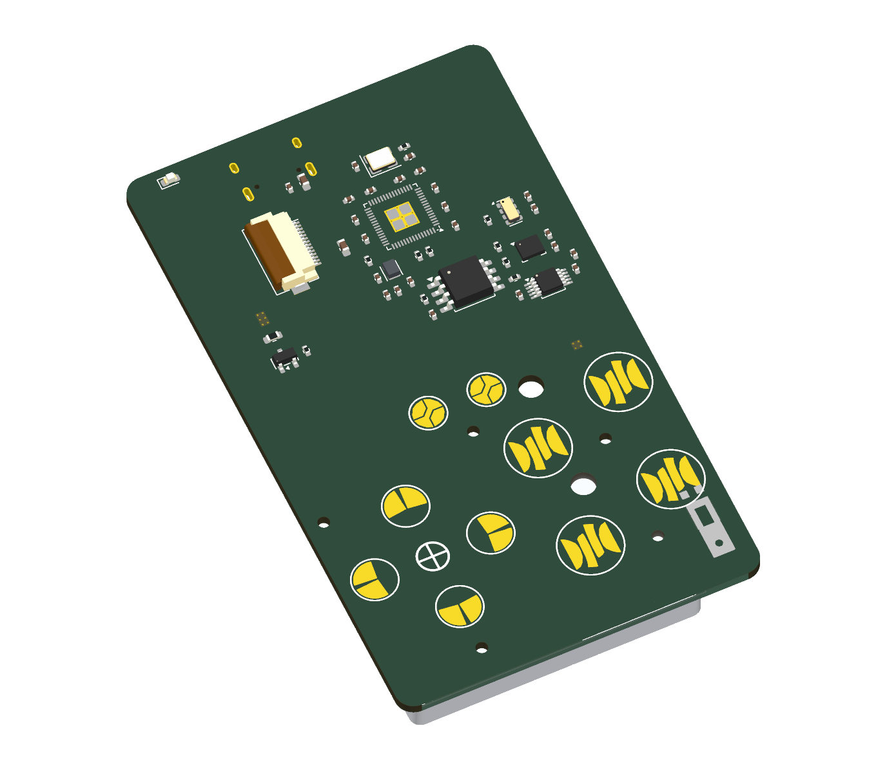
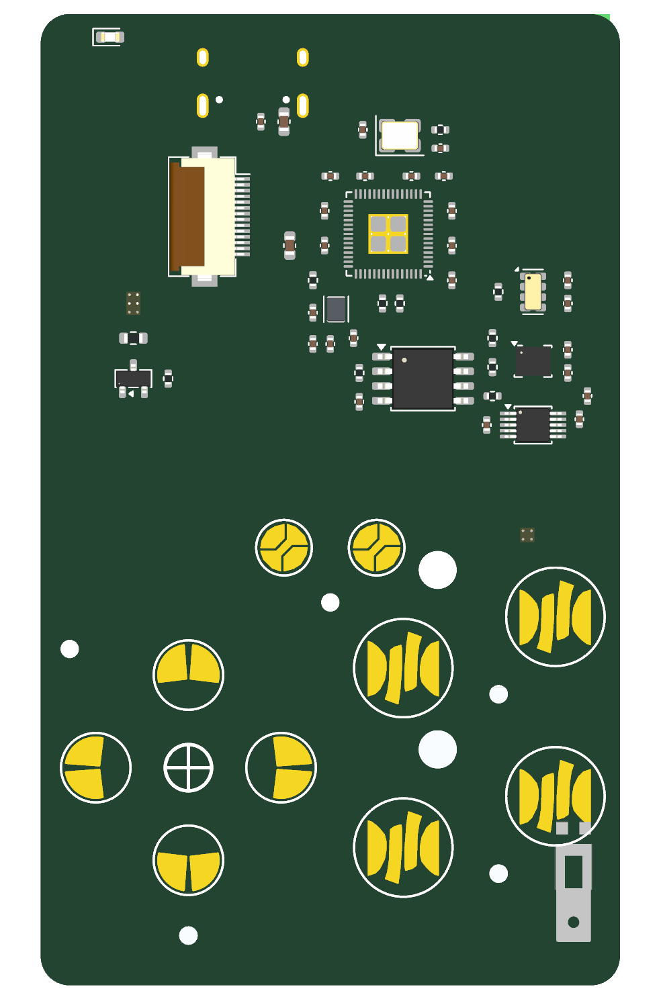
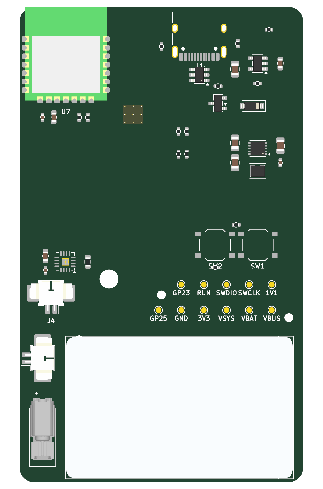

# chilichip console board

KiCad project for the all-in-one chilichip console PCB: the main board and all modules (RP2350, 2.0" screen, audio, radio, sensors, haptics, buttons) on one fully assembled board. 50 × 83.9 mm, 4 layers, fits the Slab casing.

**Status:** schematic and placement done, ERC and DRC clean. Not routed, not built.

| Front | Back |
|---|---|
|  |  |

## Docs

The MkDocs site in `docs/` has the design, pin map, power tree, schematics, layout, parts list and open points. Run `pip install -r docs/requirements.txt && mkdocs serve`.

## Files

| Path | What it is |
|---|---|
| `chilichip-console.kicad_pro` and sheets | KiCad 10 project |
| `scripts/` | Generators: `design.py` holds every part and net |
| `reference/rp2350a-minimal/` | Raspberry Pi's RP2350A minimal design, unchanged |

## Credits

The RP2350A circuit comes from Raspberry Pi's **RP2350A minimal design** ([hardware design with RP2350](https://datasheets.raspberrypi.com/rp2350/hardware-design-with-rp2350.pdf)). Thanks to Raspberry Pi Ltd for publishing it. The GBA button footprints are from [Pigweed Kudzu](https://pigweed.googlesource.com/pigweed/kudzu/+/refs/heads/main/pcb/), CC BY 4.0.

## Licence

MIT, see [LICENSE.txt](LICENSE.txt). The copyright notice is Raspberry Pi Ltd's and stays in place; chilichip's changes are added next to it.
