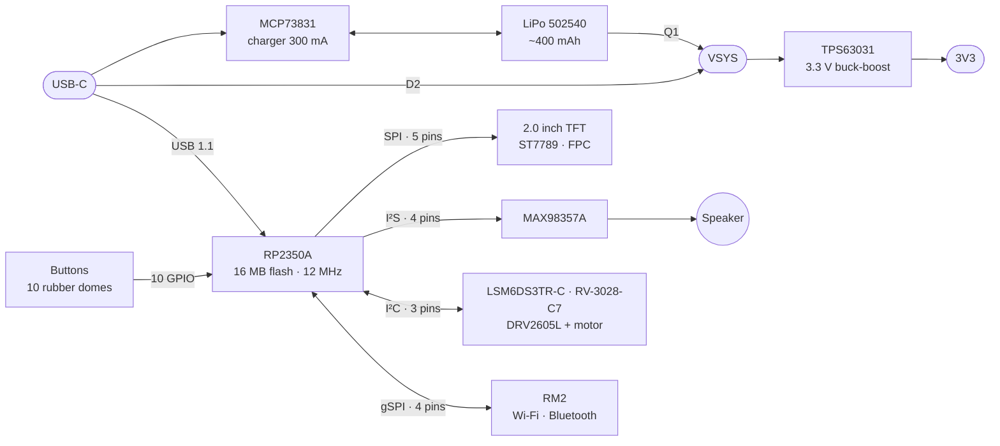
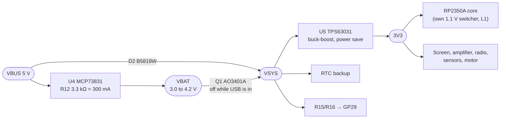

# Design

The board is the main board v4 plus all its modules, drawn as one circuit. Each block keeps the circuit of the module it came from. The pins are the same as on main board v3/v4, so the console firmware needs no new pin map.

## Block diagram

## Pin map

Same as [main board v3/v4](https://hardware.chilichip.eu/console/pin-map/). New: GP23, GP24 and GP25 were used inside the RP2350-Plus. Here GP24 senses USB power and GP23 and GP25 go to test pads.

| GPIO | Net | Goes to | Notes |
|---|---|---|---|
| GP0 | `UTIL_SDA` | IMU, RTC, haptic driver | I²C0, 4.7 kΩ pull-up R61 |
| GP1 | `UTIL_SCL` | IMU, RTC, haptic driver | I²C0, 4.7 kΩ pull-up R62 |
| GP2 | `UTIL_INT` | IMU INT1, RTC ~INT | Open drain, 10 kΩ pull-up R63 |
| GP3 | `AUDIO_DIN` | MAX98357A DIN | PIO I²S |
| GP4 | `AUDIO_BCLK` | MAX98357A BCLK | |
| GP5 | `AUDIO_LRCLK` | MAX98357A LRCLK | Must be BCLK + 1 |
| GP6 | `AUDIO_MODE` | MAX98357A SD_MODE via R40 510 kΩ | High = on, mono (L+R)/2 |
| GP7 | `BTN_A` | SW11 | Internal pull-up, low when pressed |
| GP8 | `BTN_B` | SW11 | |
| GP9 | `WIFI_ON` | RM2 WL_ON, BT_ON | |
| GP10 | `BTN_Y` | SW12 | |
| GP11 | `BTN_X` | SW12 | |
| GP12 | `BTN_SELECT` | SW13 | |
| GP13 | `WIFI_CS` | RM2 CS | |
| GP14 | `WIFI_CLK` | RM2 SCLK | |
| GP15 | `WIFI_DIO` | RM2 DI; DO via R50 470 Ω; nIRQ via R51 10 kΩ | Same as the Pico W |
| GP16 | `BTN_DOWN` | SW10 | |
| GP17 | `BTN_RIGHT` | SW10 | |
| GP18 | `BTN_START` | SW13 | |
| GP19 | `BTN_UP` | SW10 | |
| GP20 | `BTN_LEFT` | SW10 | |
| GP21 | `DISP_RST` | Panel RST, backlight switch Q2 | High = panel on and backlight on |
| GP22 | `DISP_DC` | Panel D/C | |
| GP23 | `GP23` | TP4 | **New.** Spare |
| GP24 | `VBUS_SENSE` | R17/R18 divider from VBUS | **New.** High while USB is plugged in (3.0 V at 5 V) |
| GP25 | `GP25` | TP5 | **New.** Spare (was the RP2350-Plus LED) |
| GP26 | `DISP_CLK` | Panel SCL | SPI1 SCK |
| GP27 | `DISP_DIN` | Panel SDA | SPI1 TX |
| GP28 | `DISP_CS` | Panel CS | |
| GP29 | `VSYS_SENSE` | R15/R16 divider, 200k / 100k | ADC3, one third of VSYS, as on the RP2350-Plus |

## Power

| Part | Choice | Why |
|---|---|---|
| Charger | MCP73831, 300 mA (R12 3.3 kΩ) | About 0.75 C for the 400 mAh cell. One SOT-23-5, KiCad symbol in the stock library |
| Charge light | D1 red LED from VBUS into STAT | Lit while charging, also when the console sleeps. Needs a small light hole in the shell |
| Power path | Schottky D2 from USB, P-MOSFET Q1 from the battery | Same idea as the Pico and the RP2350-Plus: the console runs from USB while the battery charges |
| 3.3 V | TPS63031 buck-boost | Keeps 3.3 V until the cell is almost empty. An LDO drops out below about 3.4 V, which wastes the bottom of the cell |
| RP2350 core | Internal switcher with L1 3.3 µH | From the RP2350A minimal design |
| No power switch | As main board v3/v4 | The firmware sleeps and wakes on Start |

The 3.3 V rail carries everything. Peak load is about 500 mA: radio bursts (~300 mA), speaker at full volume (~200 mA), backlight 45 mA, motor 77 mA, the RP2350 and flash. The TPS63031 gives about 800 mA from a 3.6 V cell.

## Changes from the modules

| Block | Change | Effect on firmware |
|---|---|---|
| Brain | RP2350-Plus replaced by the RP2350A minimal design | None. Same GPIOs, same 16 MB flash |
| Brain | GP24 senses USB power | Optional: tell "on USB" apart from a full battery |
| Brain | BOOTSEL and RESET buttons on the back | None |
| Power | Charger 300 mA instead of 1 A, buck-boost instead of LDO | None |
| Display | Module circuit on the board, FPC connector on the front under the panel | None |
| Audio | Same circuit, still on 3.3 V | None |
| Radio | Antenna on the top edge instead of the right edge | None |
| Utility | RTC backup still from VSYS. Motor terminals in normal order | None |
| Buttons | GBA pads directly on the board | None |
