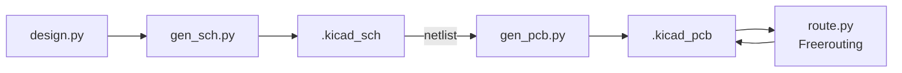

# Work on the board

The KiCad files are generated by Python scripts, so the schematic and the board always match one list of parts and nets. Change `scripts/design.py`, then run the scripts again. Small fixes can also be made in KiCad directly, but they are lost the next time the scripts run.

## Files

| Path | What it is |
|---|---|
| `chilichip-console.kicad_pro`, `.kicad_sch`, `.kicad_pcb` | The KiCad 10 project. The root sheet links the 7 block sheets (`mcu.kicad_sch` and so on) |
| `chilichip-console.kicad_sym`, `chilichip-console.pretty/` | Local symbols and footprints (RM2, utility chips, motor, GBA pads, battery outline) |
| `3d-models/` | STEP models that KiCad does not ship |
| `scripts/design.py` | Every part and the net on every pin, one list per sheet |
| `scripts/gen_sch.py` | Writes the schematic sheets |
| `scripts/gen_pcb.py` | Writes the board: outline, footprints, nets and placement |
| `scripts/route.py` | Ground plane, antenna keep-out, Freerouting, ground pours |
| `scripts/bom.py` | Parts list for the docs |
| `reference/rp2350a-minimal/` | Raspberry Pi's RP2350A minimal design, unchanged |

## Generate

Needs KiCad 10 (its Python module `pcbnew` comes with it).

```bash
python3 scripts/gen_sch.py
kicad-cli sch erc --severity-error chilichip-console.kicad_sch
kicad-cli sch export netlist --format kicadsexpr -o /tmp/console.net chilichip-console.kicad_sch
python3 scripts/gen_pcb.py /tmp/console.net
python3 scripts/route.py /path/to/freerouting-1.9.0.jar   # autoroute (needs Java and xvfb-run)
kicad-cli pcb drc --schematic-parity chilichip-console.kicad_pcb
```

Freerouting does not give the same result every run. The committed board needed a second pass on a few nets: rip up their tracks, export the DSN from the routed board, route again and import. Check DRC after every run.



## Images

```bash
kicad-cli pcb render --side top --width 1000 --height 1500 -o docs/images/top.png chilichip-console.kicad_pcb
kicad-cli pcb render --side bottom --width 1000 --height 1500 -o docs/images/bottom.png chilichip-console.kicad_pcb
kicad-cli pcb render --width 1376 --height 1176 --rotate '-35,0,20' --perspective --zoom 0.7 -o docs/images/iso.png chilichip-console.kicad_pcb
kicad-cli sch export svg --exclude-drawing-sheet -o docs/schematics chilichip-console.kicad_sch
```

## Docs

```bash
pip install -r docs/requirements.txt
mkdocs serve
```

## Credits

| What | From | Licence |
|---|---|---|
| RP2350A circuit | Raspberry Pi Ltd, RP2350A minimal design R4 | MIT (copyright notice kept in `reference/`) |
| GBA button footprints and symbols | [Pigweed Kudzu](https://pigweed.googlesource.com/pigweed/kudzu/+/refs/heads/main/pcb/) | CC BY 4.0 |
| Utility, audio and display circuits | chilichip module repos | MIT |
| RM2 symbol and 3D model | vgc-zero-hardware | MIT |
