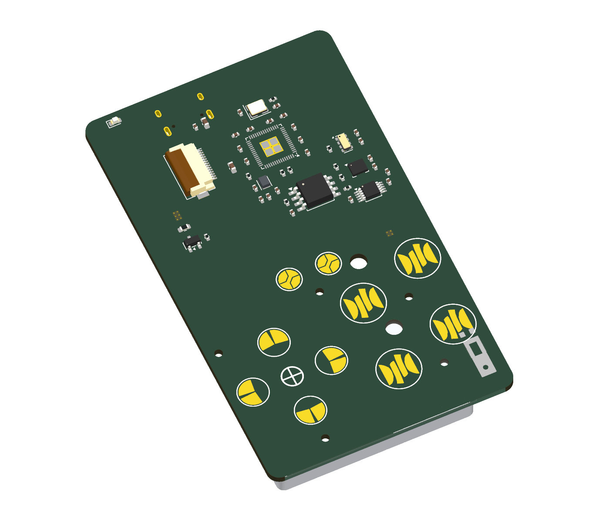
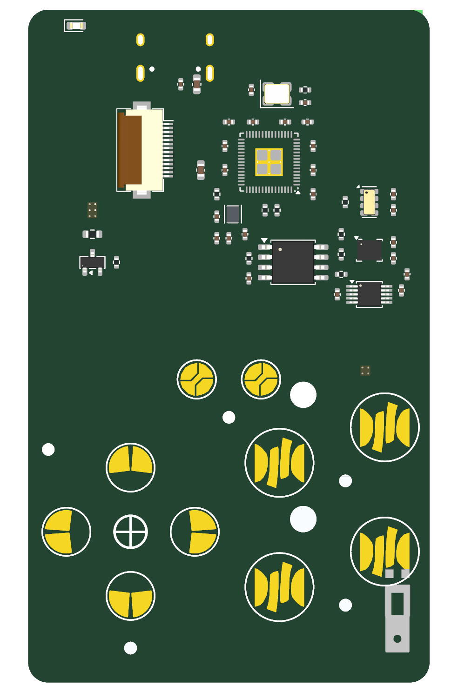
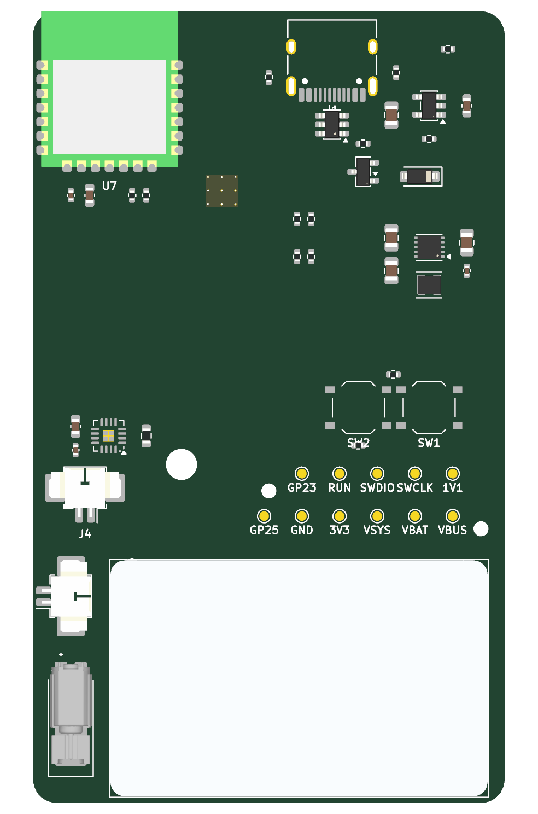

# chilichip console board

One PCB with the whole console on it. It merges the main board and every module (brain, display, audio, radio, utility and buttons) into a single board that the factory assembles. No hand soldering of modules.

!!! warning "Work in progress, not ordered yet"
    Schematic and placement are done and pass ERC and DRC. **The board is not routed yet.** Nothing here has been built or tested. See [open points](open-points.md).

{ .render loading=lazy }

<figure markdown>
{ loading=lazy }
<figcaption>Front: processor and sensors under the screen, buttons below</figcaption>
</figure>
<figure markdown>
{ loading=lazy }
<figcaption>Back: USB-C, power, radio, audio, battery</figcaption>
</figure>

## At a glance

| | |
|---|---|
| Processor | Raspberry Pi RP2350A (2 × Cortex-M33, 150 MHz, 520 KB RAM) |
| Flash | 16 MB, Winbond W25Q128JV |
| Screen | 2.0" 320 × 240 IPS TFT, buydisplay ER-TFT020-3 (ST7789), on a 14-pin FPC connector |
| Audio | MAX98357A I²S class D amplifier, speaker on a PicoBlade connector |
| Radio | Raspberry Pi Radio Module 2 (CYW43439): Wi-Fi 4 and Bluetooth 5.2 |
| Sensors | LSM6DS3TR-C IMU, RV-3028-C7 real-time clock |
| Haptics | DRV2605L driver and a Vybronics SMD ERM motor |
| Buttons | D-pad, A, B, X, Y, Start, Select: GBA rubber-dome pads on the PCB |
| Power | USB-C, MCP73831 LiPo charger (300 mA), TPS63031 3.3 V buck-boost |
| Battery | 502540 LiPo, 5 × 25 × 40 mm, about 400 mAh, on a PicoBlade plug |
| Board | 50 × 83.9 mm, 4 layers, 1.6 mm. Same outline as main board v4 |
| Fits | The Slab casing (54 × 96 × 15.8 mm) |
| Firmware | Same GPIO map as main board v3/v4, so the current console firmware runs on it |

## What it replaces

| Today (main board v4 and modules) | On this board | Source design |
|---|---|---|
| Waveshare RP2350-Plus | RP2350A, flash, crystal, USB-C, charger and regulator | Raspberry Pi RP2350A minimal design R4 ([reference/](https://github.com/chili-chip/chilichip-console-hardware/tree/master/reference/rp2350a-minimal)) |
| Display module (2.0" TFT) | FPC connector, backlight switch | [chili-display-module-hardware](https://github.com/chili-chip/chili-display-module-hardware) PR #3 |
| Audio module v1.1.1 | MAX98357A circuit | [chili-audio-module-hardware](https://github.com/chili-chip/chili-audio-module-hardware) |
| Utility module v2.0.0 | IMU, RTC, haptic driver and motor | [chili-utility-module-hardware](https://github.com/chili-chip/chili-utility-module-hardware) |
| Radio module (RM2 on the main board) | RM2, antenna on the top edge | [vgc-zero-hardware](https://github.com/chili-chip/vgc-zero-hardware) PR #49 |
| Buttons module | GBA pads straight on this board | buttons module, Pigweed Kudzu footprints |

The circuits are copied as they are, so what works on the modules works here. The [design](design.md) page lists every change.

## Pages

| Page | What is in it |
|---|---|
| [Design](design.md) | Block diagram, pin map, power tree, what changed from the modules |
| [Schematics](schematics.md) | All seven sheets |
| [Board layout](layout.md) | Where everything sits, keep-outs, stack-up, rules |
| [Parts list](parts.md) | Every part with its LCSC number |
| [Open points](open-points.md) | What is left before the first order |
| [Work on the board](develop.md) | How the files are generated, commands, credits |
