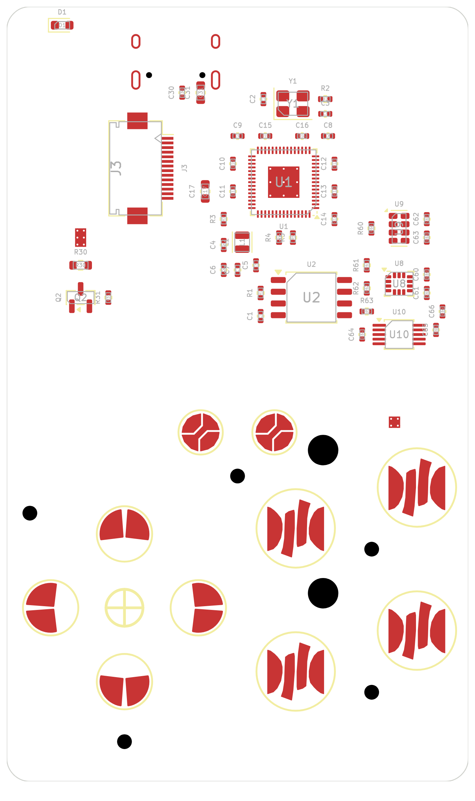
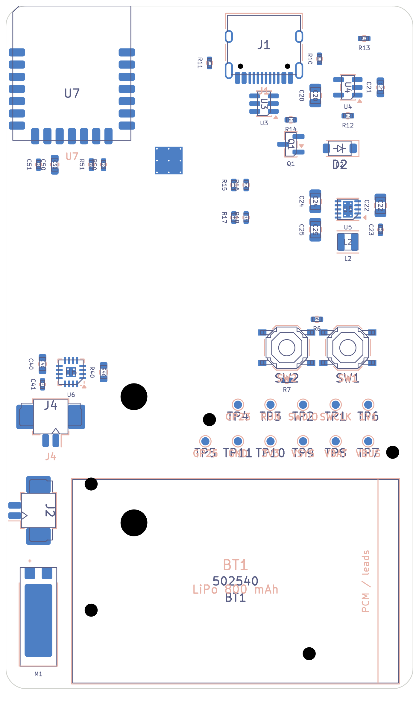
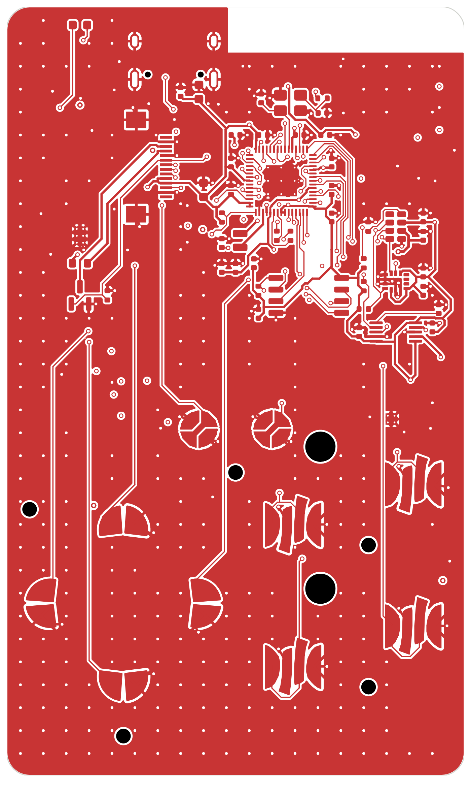
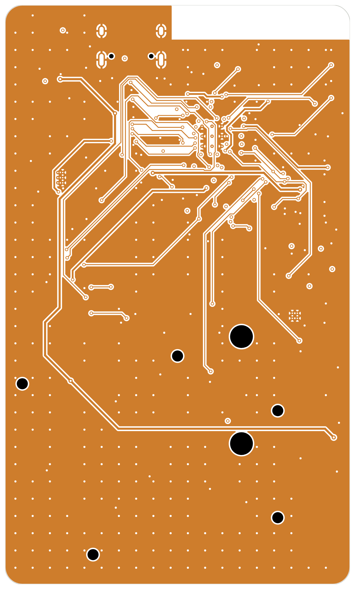
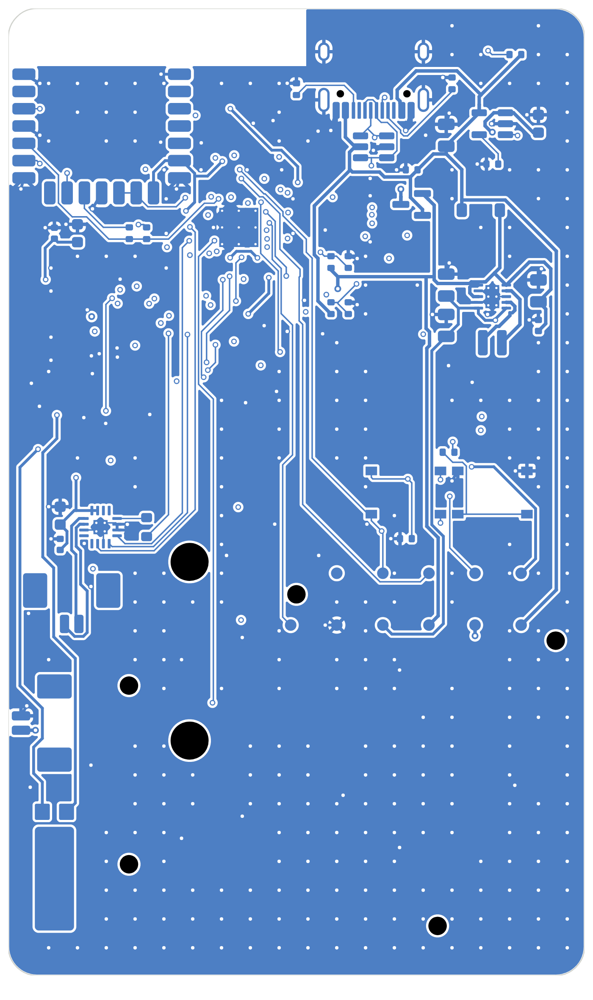

# Board layout

The board keeps the outline of main board v4 (50 × 83.9 mm, 2.5 mm corners, no holes for screws), so the Slab casing fits as it is. The only part that moves for the casing is the USB-C port: **1.0 mm to the left** (centre at x 18.3 mm instead of 19.3 mm) to clear the antenna keep-out.

Coordinates below are in mm from the top-left corner, seen from the front.

## Front

Under the 2.0" panel (x 1.1 to 48.9, y 5.7 to 40.3, centred on the display position the casing uses) the board carries the processor, flash, crystal, sensors and the display connector. The panel sits on the casing frame about 3.6 mm above the board, so parts here must stay under 2.5 mm. The tallest is the flash (SOIC-8, 2.2 mm).

Below the panel are the button contacts, at the same centres as the buttons module.

{ .render loading=lazy }

| Area | Parts | Notes |
|---|---|---|
| x 0 to 14, y 12 to 23 | Nothing | The panel's FPC tail folds back under the panel here |
| x 15.6, y 17.5 | J3 FPC connector, opening to the left | Same spot as the display module's J2 on main board v4 |
| Centre | U1 RP2350A (turned 180°), U2 flash, Y1 crystal, L1 | Display pins face J3, radio pins face the RM2, QSPI pins face the flash |
| Right | U8 IMU, U9 RTC, U10 haptic driver | Near the I²C pins |
| (8, 2), above the panel | D1 charge LED | Under a 1.6 mm frosted light pipe in the shell, clear of the screw boss at (2.5, 2.5) |
| D-pad (12.75, 65.1) | SW10 | GBA D-pad pad |
| B (31.3, 72.0), A (44.5, 67.6) | SW11 | GBA A/B pad |
| X (31.3, 56.5), Y (44.5, 52.1) | SW12 | Same footprint as A/B |
| Start (21, 46.1), Select (29, 46.1) | SW13 | GBA Start/Select pad |

## Back

{ .render loading=lazy }

| Area | Parts | Notes |
|---|---|---|
| Top edge, x 18.3 | J1 USB-C, U3 ESD, CC resistors | Mouth 0.5 mm past the edge |
| Top-left (front view) | U4 charger, Q1, D2, U5 buck-boost, L2 | Short path from USB to the battery |
| Top-right (front view) | U7 RM2 | Antenna flush with the top edge |
| Middle | SW1 BOOTSEL, SW2 RESET, 11 test pads | Reachable with the back cover off |
| Right strip | U6 amplifier, J4 speaker, J2 battery, M1 motor | Next to the battery |
| x 1.8 to 41.8, y 58.2 to 83.2 | Battery 502540 | Nothing under it. Leads exit at the right end into J2 |

## Antenna keep-out

The RM2 antenna is at the top edge, as decided for the next board. The area x 24.15 to 50, y 0 to 5 has no copper on any layer (a rule area in the board). The RM2 footprint's own keep-out reaches 13.5 mm past the edge, which is outside the board.

The panel starts at y 5.7, so it stays clear of the keep-out.

## Stack-up and rules

| | |
|---|---|
| Layers | 4: F.Cu signals, In1.Cu solid ground, In2.Cu signals + ground fill, B.Cu signals + ground fill |
| Thickness | 1.6 mm |
| Track / clearance | 0.127 / 0.127 mm (signals), 0.25 mm (3V3, 1V1, speaker, motor, backlight), 0.3 mm (battery, USB power, buck-boost inductor) |
| Vias | 0.5 / 0.3 mm (JLCPCB standard, no extra cost) |
| Thermal vias | 0.2 mm in the RP2350, MAX98357A and TPS63031 pads |
| Copper to edge | 0.3 mm |

## Routing

The board is autorouted with Freerouting 1.9.0 by `scripts/route.py`:

1. Every ground pad gets a short track and a via to the In1 ground plane (fanout). These are locked so the router keeps them.
2. Freerouting routes all other nets on F.Cu, In2.Cu and B.Cu.
3. Ground pours fill F.Cu, In2.Cu and B.Cu. Vias on a 2.5 mm grid tie the pours to In1, and every pour island gets at least one via.

| | |
|---|---|
| Tracks | about 1,250 segments, 2.4 m in total |
| Vias | 466 (about 270 of them ground stitching) |
| Open | 3 connections at U1, see [open points](open-points.md) |

No vias sit in the antenna keep-out or under the USB-C shell.

=== "F.Cu (front)"

    { .render loading=lazy }

=== "In2.Cu"

    { .render loading=lazy }

=== "B.Cu (seen from the back)"

    { .render loading=lazy }

## Heights

| Side | Tallest part | Height above the board |
|---|---|---|
| Front, under the panel | U2 flash (SOIC-8) | 2.2 mm |
| Back | Battery + tape | 5.3 mm |
| Back | M1 motor | 4.3 mm |
| Back | J1 USB-C | 3.2 mm |
