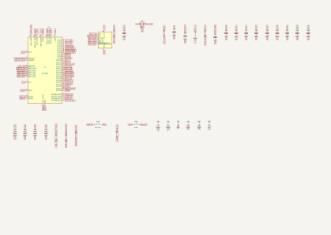
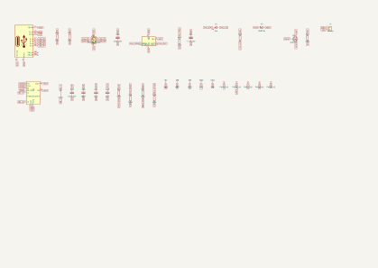
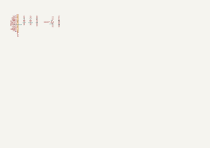
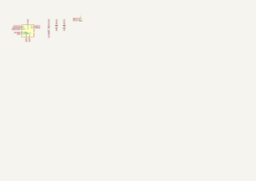
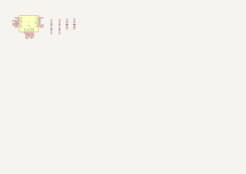
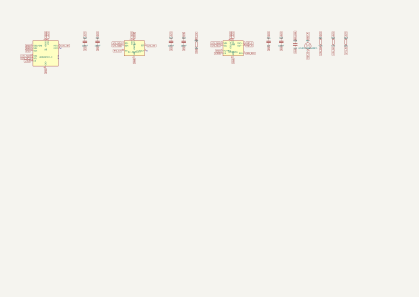
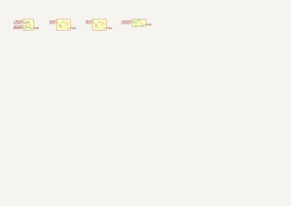

# Schematics

Seven sheets, one per block. Every pin has a label with its net name, so the sheets connect by name. The schematic is generated from `scripts/design.py`; see [work on the board](develop.md). Click a sheet to open it full size.

| Sheet | What is on it |
|---|---|
| [MCU](#mcu) | RP2350A, flash, crystal, core supply, USB data, BOOTSEL and RESET, SWD pads |
| [Power](#power) | USB-C, ESD, charger, power path, buck-boost, battery, sense dividers |
| [Display](#display) | FPC connector and backlight switch |
| [Audio](#audio) | MAX98357A and the speaker connector |
| [Radio](#radio) | RM2 |
| [Utility](#utility) | IMU, RTC, haptic driver, motor |
| [Buttons](#buttons) | Rubber-dome contacts |

## MCU

[{ loading=lazy }](schematics/mcu.svg)

## Power

[{ loading=lazy }](schematics/power.svg)

## Display

[{ loading=lazy }](schematics/display.svg)

## Audio

[{ loading=lazy }](schematics/audio.svg)

## Radio

[{ loading=lazy }](schematics/radio.svg)

## Utility

[{ loading=lazy }](schematics/utility.svg)

## Buttons

[{ loading=lazy }](schematics/buttons.svg)
